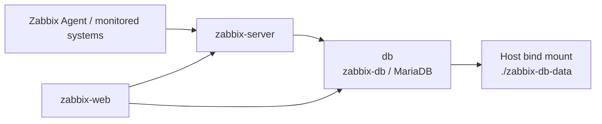

# MariaDB — Zabbix Database and Persistence

**English** | [Português (Brasil)](../../pt-BR/servicos/mariadb-zabbix/README.md)  
[Technical documentation](../../README.md) · [Docker infrastructure](../../containers/docker-services.md)

## 1. Why this database is critical

MariaDB is the database dependency of the laboratory's Zabbix Server and Zabbix Web interface. Without a healthy, accessible database, Zabbix processing and the web application's database-dependent functions can fail even when the front-end container or an unrelated dashboard is running.

The November 6, 2026 container inventory includes `zabbix-db`. The versioned [Compose example](../../../docker_configs/docker-compose.yml) specifies the service key `db`, container name `zabbix-db` and image `mariadb:11.4`. This is a **configuration record**, not a database dump, proof of current health or verified recovery test.

## 2. Dependency and data paths



`zabbix-server` and `zabbix-web` use `DB_SERVER_HOST: db`. The name `db` is a Compose service name on `zabbix-net`; the container name shown to administrators is `zabbix-db`. Grafana visualizes selected Zabbix data, so a database-side failure can indirectly affect monitoring views; this diagram does not assert a specific live Grafana-to-database connection.

## 3. Configuration inventory

| Setting in public Compose | Documented value | Purpose |
| --- | --- | --- |
| Image | `mariadb:11.4` | Database service |
| Compose service | `db` | Network service name |
| Container | `zabbix-db` | Docker inventory name |
| Database name | `ZABBIX_DB_NAME`, default `zabbix` | Zabbix application schema |
| Application user | `ZABBIX_DB_USER`, default `zabbix` | Zabbix database account |
| Password inputs | `ZABBIX_DB_PASSWORD` and `MARIADB_ROOT_PASSWORD` | Private environment variables required at startup |
| Character set / collation | `utf8mb4` / `utf8mb4_bin` | Declared database options |
| InnoDB buffer pool | `512M` | Declared memory setting |
| Maximum connections | `300` | Declared server limit |
| Persistent data | `./zabbix-db-data:/var/lib/mysql` | Host-mounted database files |
| Network | `zabbix-net` | Application network |
| Host port | **Not published** | The Compose example has no `3306:3306` mapping |

The application credentials are represented by placeholders in [`.env.example`](../../../docker_configs/.env.example); **real secrets do not belong in Git**. The absent host-port mapping does not prove that the database is unreachable from every other container or host route.

## 4. Startup and health-check semantics

The database defines the `healthcheck.sh` check with `--connect` and `--innodb_initialized`, a 5-second interval, 5-second timeout, 30 retries and 15-second start period. In the Compose example:

- `zabbix-server` waits for `db` with `condition: service_healthy`.
- `zabbix-web` waits for healthy `db` and for `zabbix-server` to have **started**.
- Zabbix Server and Zabbix Web receive their database credentials through environment-variable interpolation.

A passing container health check is **not** proof that Zabbix has the right schema, that all queries succeed, that every item is collected or that Grafana panels are accurate. The declared dependency describes startup ordering, not complete application readiness.

## 5. Persistence, recovery and security

The `zabbix-db-data/` directory is a host bind mount and is ignored by Git. It can preserve database files across normal container replacement **when storage is handled correctly**, but **persistence is not a backup**. The repository contains no verified database backup policy, tested restore procedure, replication configuration, high-availability cluster or measured recovery-time objective.

A responsible recovery design would require, **as future verification rather than an implemented feature**, a consistent backup method, retention rules, protected storage, restore rehearsal, disk-capacity monitoring and a procedure matching the deployed MariaDB/Zabbix versions. Avoid removing volumes or recreating databases as a routine response to failures.

Access to MariaDB and its credentials should be restricted to authorized administrators and the application. Even read-only diagnostic commands and log exports require redaction checks; never publish SQL dumps, authentication values or personal information from monitoring records.

## 6. Non-disruptive investigation sequence

| Symptom | First checks | Do not conclude without |
| --- | --- | --- |
| `db` unhealthy or exited | Container lifecycle, recent logs, host disk and permissions | Actual health-check error and root cause |
| Zabbix Web unavailable | `zabbix-web`, `zabbix-server` and `db` dependencies | Application response and database connectivity evidence |
| Zabbix missing new metrics | Items, server logs, queue and DB status | A confirmed database failure; agent/SNMP issues are different |
| Grafana `No data` | Data source, Zabbix API/item history, time range | Database fault confirmed by independent evidence |
| Data missing after recreation | Host mount path and backup/restore records | Proof that the expected dataset existed and was restored |

Reference **read-only commands**, not executed during documentation preparation:

```bash
docker ps --filter name=zabbix-db --format 'table {{.Names}}\t{{.Status}}\t{{.Ports}}'
docker inspect --format '{{.State.Status}} {{if .State.Health}}{{.State.Health.Status}}{{else}}no-healthcheck{{end}}' zabbix-db
docker logs --tail 80 zabbix-db
```

Run only on an authorized host. Logs may reveal sensitive operational details and must be reviewed before sharing. For actual application-level validation, use approved database checks with credentials held outside the repository; record the real result rather than assuming success.

## 7. Evidence boundaries and references

**Documented:** dated Docker inventory, MariaDB image and settings, persistent mount, private-variable placeholders, declared Compose health check and Zabbix dependencies.  
**Not documented as proven:** a successful recent database query, tested backup/restore, data durability during host failure, HA, operational uptime or a specific root cause for monitoring gaps.

Related: [Zabbix monitoring](../../monitoring/zabbix-monitoring.md) · [Docker failure runbook](../../noc-operations/runbooks/docker-service-failure.md) · [Grafana monitoring](../../monitoring/grafana-monitoring.md).
