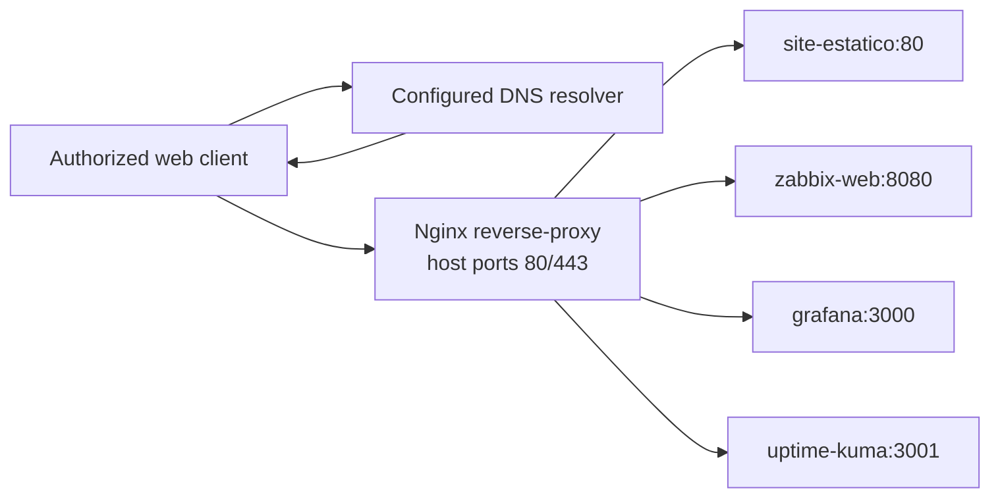

# Nginx Reverse Proxy — Service Architecture and Operations

**English** | [Português (Brasil)](../../pt-BR/servicos/nginx-proxy-reverso/README.md)  
[Technical documentation](../../README.md) · [Docker infrastructure](../../containers/docker-services.md)

## 1. Role in the laboratory

Nginx provides HTTP/HTTPS reverse-proxy routing for the Enterprise NOC laboratory. It receives a web request addressed to a configured virtual host and forwards it to a service container on the Compose network. The public configuration is a **sanitized reference**; it is not proof that every route, hostname, or TLS connection was verified from each laboratory VLAN.

The November 6, 2026 Docker inventory records the `reverse-proxy` container. The versioned [Compose file](../../../docker_configs/docker-compose.yml) declares `nginx:alpine`, ports `80:80` and `443:443`, and the `zabbix-net` bridge network.

## 2. Request path



DNS determines the destination address before the HTTP request; Nginx uses the request hostname for virtual-host selection. **A DNS record is not a proxy rule**, and a proxy route is not proof that an upstream is healthy or reachable from every client network.

## 3. Virtual hosts in the published configuration

| Sanitized hostname | Nginx upstream | Purpose |
| --- | --- | --- |
| `portal.noc.example.test` | `http://site-estatico:80` | Local static portal |
| `zabbix.noc.example.test` | `http://zabbix-web:8080` | Zabbix web interface |
| `grafana.noc.example.test` | `http://grafana:3000` | Grafana dashboards |
| `status.noc.example.test` | `http://uptime-kuma:3001` | Uptime Kuma |

These `example.test` names are **illustrative**, not published DNS entries. The sample contains no Nginx virtual hosts for Pi-hole or Portainer, even though those applications appear elsewhere in the laboratory inventory. The portal served by `site-estatico` is also distinct from the public GitHub Pages site in `docs/`.

## 4. Configuration and Docker dependencies

The configuration is split between:

- [`nginx.conf`](../../../docker_configs/reverse-proxy/nginx.conf): worker/event and HTTP settings, TLS certificate references, allowed TLS protocol versions, upgrade mapping, and inclusion of virtual-host files.
- [`conf.d/lab.conf`](../../../docker_configs/reverse-proxy/conf.d/lab.conf): listeners, `server_name` selections, upstream `proxy_pass` targets, forwarded request headers and application-specific proxy settings.
- [`docker-compose.yml`](../../../docker_configs/docker-compose.yml): image, published ports, bind mounts, network and `depends_on` declarations.

The Compose example mounts `nginx.conf`, `conf.d/` and `certs/` read-only inside the proxy container. Local TLS certificates under `docker_configs/reverse-proxy/certs/` are deliberately not in Git. Without the appropriate host files and certificates, a clone of the public example is not a complete executable deployment. `depends_on` only orders startup; it does **not** establish HTTP readiness or a successful TLS handshake.

## 5. TLS, exposure and security boundaries

- `nginx.conf` references `/etc/nginx/certs/lab.crt` and `lab.key` and allows TLS 1.2/1.3. The certificate issuer, trust chain, expiry, hostname matching and successful handshakes are **not established** by the public files.
- Both HTTP 80 and HTTPS 443 are configured. The published virtual hosts do **not** contain an HTTP-to-HTTPS redirect; do not describe HTTPS enforcement or HSTS as implemented.
- The proxy forwards `Host`, `X-Real-IP`, `X-Forwarded-For` and `X-Forwarded-Proto`. Their presence does not prove application-side trust, authentication, filtering or access control.
- Compose also publishes application host ports directly (`8081`, `8082`, `3000` and `3001`). **Nginx is not proven to be the only access path.** Restricting direct access would require separate firewall or network-policy evidence.
- Nginx's route definitions do not prove the internal DNS, client VLAN reachability, certificate deployment, authentication or application health.

## 6. Failure domains and read-only investigation

| Observation | First dependency to distinguish | Evidence required |
| --- | --- | --- |
| Name does not resolve | Client DNS configuration / selected resolver | Authorized DNS response and intended target |
| Connection to host fails | Client route, firewall, host listener | Source network, TCP result and listener status |
| TLS warning or failure | Certificate, name and trust chain | Certificate inspection and actual handshake result |
| `502` or `504` response | Upstream name, port, container and network | Dated Nginx error and backend checks |
| Page loads but shows errors | Application/database/backend | Application-specific functional checks |
| HTTP succeeds but HTTPS fails | TLS path, not necessarily application | Separate protocol tests and certificate result |

Reference commands to run **only on the authorized deployment host**, not tests performed for this documentation:

```bash
docker ps --filter name=reverse-proxy --format 'table {{.Names}}\t{{.Status}}\t{{.Ports}}'
docker exec reverse-proxy nginx -t
docker logs --tail 80 reverse-proxy
```

`nginx -t` validates configuration syntax and loading conditions in the running container; it does not test users' DNS resolution or end-to-end application behavior. Logs may contain client identifiers or request data: redact sensitive information before publication. Do not restart containers, alter routes or replace certificates without approval and rollback planning.

## 7. Evidence boundaries and references

**Documented:** container inventory on November 6, public Compose service, sample Nginx configuration and declared upstreams.  
**Not demonstrated:** live request tests from every VLAN, production TLS validity, access restrictions for direct backend ports, HTTP-to-HTTPS enforcement, or continuous availability.

Related: [DNS and availability](../../services/dns-and-availability.md) · [Docker troubleshooting runbook](../../noc-operations/runbooks/docker-service-failure.md) · [Website documentation](../../site/README.md).
